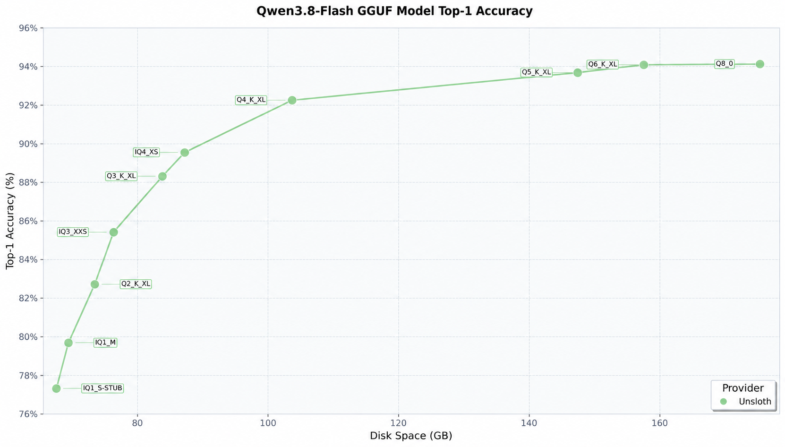
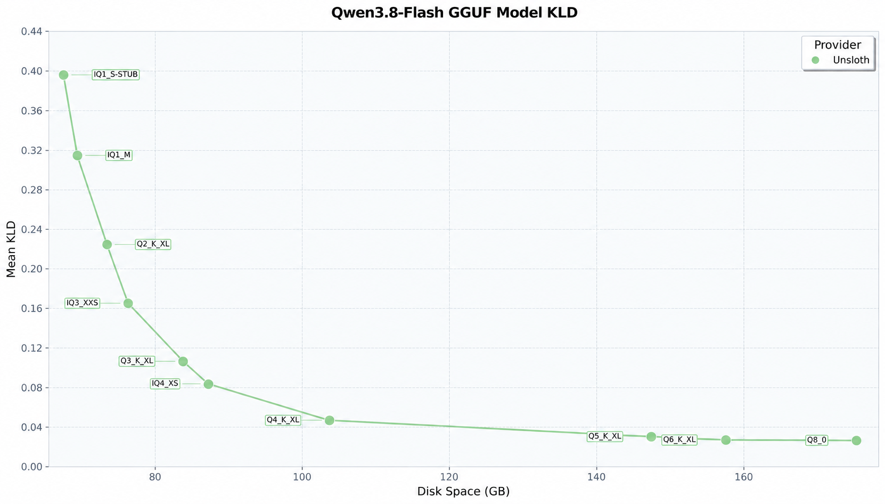

# Local LLM Inference on GEEKOM A9 Mega

This repository answers two questions for end customers, using data measured on physical GEEKOM hardware:

1. When running a large language model locally on a mini PC, **which quantization level should you choose?**
2. Once that level is chosen, **what performance can each GEEKOM A9 Mega model (for example the A9 Mega 388) actually deliver?**

The short answer: **4-bit quantization is the sweet spot between file size and accuracy**, and it is the level used for every performance test in this repository.

All performance data was measured on physical GEEKOM units. **The device configuration, exact model versions, and launch commands are published together with the results**, and anything not tested is marked "Not tested".

Full records for each device, including test commands, VRAM usage, and notes:

- A9 Mega 388 — all 34 test records: [`docs/A9-Mega-388/`](./docs/A9-Mega-388/)
- A9 Mega 395 — all 35 test records: [`docs/A9-Mega-395/`](./docs/A9-Mega-395/)

> **Release status**: the results have not yet been reproduced by two independent clean QA installations, and hardware details (operating system, BIOS, driver, power profile) are still being collected. These will be completed before release.

## Contents

1. [Quantization bits vs. model file size](#1-quantization-bits-vs-model-file-size)
2. [Quantization bits vs. model accuracy](#2-quantization-bits-vs-model-accuracy)
3. [Conclusion: 4-bit is the sweet spot](#3-conclusion-4-bit-is-the-sweet-spot)
4. [Measured 4-bit performance by device](#4-measured-4-bit-performance-by-device)

---

## 1. Quantization bits vs. model file size

Quantization means **representing a single weight with fewer bits** (often written as *bits per weight*, or **bpw**). Using this repository's primary model, **Qwen3.8-Flash-Next**, as the example:

| Quantization level | 1-bit | 2-bit | 3-bit | 4-bit | 5-bit | 8-bit | BF16 |
| --- | --- | --- | --- | --- | --- | --- | --- |
| Typical GGUF quantization | `IQ1_S` / `IQ1_M` | `Q2_K_XL` | `IQ3_XXS` / `Q3_K_XL` | `IQ4_XS` / `Q4_K_XL` | `Q5_K_XL` | `Q8_0` | BF16 |
| Model size (disk ≈ weight memory at runtime, excluding cache) | 75 GB | 79 GB | 90 GB | 96–114 GB | 163 GB | 200 GB | 355 GB |

Three points follow from this table:

- **Size grows monotonically with quantization bits**: the more bits used per weight, the larger the model file, and the more video memory / system memory it occupies at runtime.
- **Size grows gently at low quantization bits**: 1-bit to 4-bit only moves from 75 GB to 96–114 GB (roughly +30% to +50%), yet that is already enough to hold this hundred-gigabyte-class flagship model.
- **Size expands sharply at high quantization bits**: BF16 (355 GB) is more than three times the size of 4-bit, and 8-bit (200 GB) is likewise far beyond the memory capacity of a mainstream mini PC. Both place an order-of-magnitude higher demand on memory capacity and memory bandwidth.

**What this means when choosing a device**: quantization bits are not "the higher the better", they are "high enough is enough". Whether a given machine can run the model at all is decided mainly by whether its memory capacity can hold the corresponding file size, plus the runtime overhead carried on top of it — above all the context cache (KV cache), which grows with context length. In the 395 dual-node test in Section 4.2, the 111.4 GB 4-bit flagship occupies 101.41 GB at 128 tokens but 114.83 GB at 256K. Memory capacity therefore decides both the model size a device can carry and the context length it can serve.

## 2. Quantization bits vs. model accuracy

Both charts below come from Unsloth's evaluation of the Qwen3.8-Flash GGUF quantizations. The horizontal axis is disk space (GB) throughout. Because disk space maps one-to-one onto quantization level for a given model, **it can be read directly as quantization bits**.

### Top-1 accuracy



- The vertical axis is Top-1 accuracy (%). Accuracy improves as quantization bits rise, but the curve flattens progressively.
- Very low quantization bits lose a great deal: `IQ1_S-STUB` (about 72 GB) reaches only about 77%, and `IQ1_M` (about 73 GB) about 80%.
- There is still a large gain from `IQ3_XXS` (about 85%) to `Q4_K_XL` (about 92%), which places the 3–4 bit range at the value inflection point.
- Beyond `Q4_K_XL` (about 103 GB) the curve flattens: `Q5_K_XL`, `Q6_K_XL`, `Q8_0` and larger sizes add only about 1%–2%, converging at about 94%.

### KL divergence (KLD)



- The vertical axis is mean KLD (Kullback-Leibler divergence) — the distribution gap against the full-precision model; **lower is better**.
- The curve falls monotonically as quantization bits rise and shows the same saturation:
  - `IQ1_S-STUB` is about 0.40 and `IQ1_M` about 0.31 — extremely low quantization bits differ substantially from the original model.
  - `Q2_K_XL` about 0.23, `IQ3_XXS` about 0.16, `Q3_K_XL` about 0.11, `IQ4_XS` about 0.08.
  - After `Q4_K_XL` (about 103 GB) it drops below 0.05; `Q5_K_XL` and higher quantization bits settle at around 0.03.

## 3. Conclusion: 4-bit is the sweet spot

Reading the file-size results (Section 1) and the accuracy results (Section 2) together:

1. **Size and accuracy are positively correlated**: higher quantization bits give higher Top-1 and lower KLD, and the two charts corroborate each other.
2. **Marginal returns diminish**: beyond roughly 100 GB (`Q4_K_XL`) the improvement is very small. Compared with 4-bit, 5-bit / 8-bit / BF16 are close to double or even triple the size for only about 1%–2% more Top-1 and a KLD improvement from about 0.05 to about 0.03 — a cost far out of proportion to the gain.
3. **Low-bit quantization costs a lot**: 1–2 bit is only slightly smaller than 3-bit, yet Top-1 is 5–10 percentage points lower and KLD is several times higher — capacity saved, model ruined.
4. **At the same file size, the quantization scheme matters**: `IQ1_S`, `IQ1_M`, `Q2_K_XL` and `IQ3_XXS` are all around 72–75 GB, yet accuracy spreads from 77% to 85% and KLD falls from 0.40 to 0.16.

> **4-bit quantization such as `Q4_K_XL` is therefore the sweet spot**: it delivers near-saturated accuracy (Top-1 about 92%, KLD below 0.05) at 96–114 GB, a size that mainstream high-memory machines can carry.
>
> This is why every device performance test in this repository **uses 4-bit quantization**.

## 4. Measured 4-bit performance by device

### 4.1 Devices and hardware configuration

| Item | A9 Mega 388 | A9 Mega 395 |
| --- | --- | --- |
| Processor | AMD Ryzen AI MAX+ 388 | AMD Ryzen AI MAX+ 395 |
| Graphics | Radeon 8060S | Radeon 8060S |
| Memory bandwidth | 256 GB/s | 256 GB/s |
| Memory | 64 GB | 128 GB |
| Operating system | Ubuntu26.04 | Ubuntu26.04 |
| Graphics Driver | 31.50.0 0 | 31.50.0 0 |


> Both devices use the same graphics processor and the same memory bandwidth. **The main difference is memory capacity (64 GB vs. 128 GB)**, which directly determines the model sizes a single device can hold and the context lengths it can serve.

### 4.2 Primary model: Qwen3.8-Flash-Next UD-Q4_K_XL (dual-node cascade)

Shared test conditions:

| Item | Configuration |
| --- | --- |
| Model | `Qwen3.8-Flash-Next-UD-Q4_K_XL.gguf` (111.4 GB, the upper end of the 4-bit range in Section 1) + draft model `mtp-Qwen3.8-Flash-Next-Q4_K_M.gguf` (2.8 GB) |
| Acceleration | `Yes(MTP)`, `--spec-type draft-mtp --spec-draft-n-max 2` |
| Context length | `-c 256000`, `-fa on` |
| Deployment | Dual-node cascade (llama.cpp `ggml-rpc-server` with `--rpc`) |

> **Disclosed difference**: the 388 test used `-b 2048 -ub 1024`, while the 395 test used `-b 4096 -ub 2048`; the llama.cpp builds used may also differ. **The prefill rate and time-to-first-token columns in the table below should be read with that difference in mind.** Decode rate is the more directly comparable metric.

| Input length | 388 TTFT (s) | 388 decode (tokens/s) | 388 VRAM (GB) | 395 TTFT (s) | 395 decode (tokens/s) | 395 VRAM (GB) |
| --- | --- | --- | --- | --- | --- | --- |
| 128 | 2.59 | 30.76 | 62.4/57.5 | 1.19 | 34.27 | 101.41/64.86 |
| 8K | 28.62 | 26.14 | 63.8/57.7 | 20.01 | 30.66 | 102.47/64.95 |
| 16K | 56.61 | 25.62 | 63.7/57.8 | 41.26 | 27.78 | 103.06/64.97 |
| 32K | 131.34 | 23.68 | 64.7/57.8 | 90.93 | 27.9 | 103.70/64.88 |
| 128K | 861.41 | 10.62 | 65.7/58.05 | 566.5 | 15.16 | 107.35/64.77 |
| 256K | Not tested | Not tested | Not tested | 1544.66 | 10.5 | 114.83/64.95 |

VRAM is recorded as "host / worker".

**Reading the results**:

- Both devices can run the 111.4 GB flagship 4-bit model through a dual-node cascade, which is the direct benefit of 4-bit being the sweet spot.
- The A9 Mega 395 (128 GB memory) still runs at the full 256K context, decoding 15.16 tokens/s at 128K. The 388 was tested up to 128K (10.62 tokens/s); 256K was not tested.
- As context grows, decode rate falls clearly and time to first token rises sharply on both devices. This is inherent to long-context inference, not a defect of either device.

### 4.3 Other 4-bit models on the A9 Mega 388 (decode rate, tokens/s)

| Model | Size | Acceleration | 128 | 8K | 16K | 32K | 64K | 128K | 256K |
| --- | --- | --- | --- | --- | --- | --- | --- | --- | --- |
| Triple-node cascade Qwen3.8-Flash-Next-UD-Q4_K_XL | 111.4 GB | MTP N=2 | 28.00 | 26.90 | 23.94 | 22.85 | Not tested | 12.28 | Not tested |
| Qwen3.8-27B-Q4_K_M | — | MTP N=4 | 20.24 | 21.30 | 19.53 | 16.87 | Not tested | 9.88 | 6.06 |
| Gemma-4-31B_q4_0-it | — | No | 11.28 | 10.20 | 9.64 | 8.56 | Not tested | 5.00 | Test failed |
| Qwen3.6-35B-A3B-UD-Q4_K_M | 22.7 GB | MTP N=2 | 68.03 | 67.76 | 63.55 | 54.30 | Not tested | 32.61 | 21.66 |
| MiniCPM5-2B-Q4_K_M | — | No | 103.10 | 87.08 | 75.15 | 61.74 | 44.76 | 29.03 | Not tested |

Corresponding time to first token (s):

| Model | 128 | 8K | 16K | 32K | 64K | 128K | 256K |
| --- | --- | --- | --- | --- | --- | --- | --- |
| Triple-node cascade Qwen3.8-Flash-Next-UD-Q4_K_XL | 2.66 | 28.84 | 60.52 | 137.89 | Not tested | 912.65 | Not tested |
| Qwen3.8-27B-Q4_K_M | 1.50 | 25.00 | 66.00 | 109.00 | Not tested | 582.00 | 1466.00 |
| Gemma-4-31B_q4_0-it | 8.68 | 127.53 | 283.61 | 844.18 | Not tested | 10895.64 | Test failed |
| Qwen3.6-35B-A3B-UD-Q4_K_M | 0.50 | 6.70 | 18.00 | 32.00 | Not tested | 196.00 | 542.00 |
| MiniCPM5-2B-Q4_K_M | 0.20 | 3.10 | 7.40 | 20.00 | 67.00 | 243.00 | Not tested |

**Reading the results**:

- **MoE models around 35B-A3B are the 388's comfort zone**: `Qwen3.6-35B-A3B-UD-Q4_K_M` (22.7 GB) still decodes at 54.3 tokens/s at 32K and 32.61 tokens/s at 128K.
- 27B-class dense models and the 31B-class model drop to 5–10 tokens/s at long context, so they suit medium context lengths.
- 2B-class small models (MiniCPM5-2B, about 15–18 GB) reach the hundreds-of-tokens-per-second range, suited to lightweight assistant workloads.
- The Gemma-4-31B 256K run errored with no output. It is recorded as failed, with no speculation added.

### 4.4 Other 4-bit models on the A9 Mega 395 (decode rate, tokens/s)

| Model | Acceleration | 128 | 8K | 16K | 32K | 64K | 128K | 256K |
| --- | --- | --- | --- | --- | --- | --- | --- | --- |
| Qwen3.8-27B-FP4-FAST | MTP N=4 | 31.29 | 25.43 | 24.51 | 20.28 | Not tested | 8.95 | 6.06 |

Corresponding time to first token (s):

| Model | 128 | 8K | 16K | 32K | 64K | 128K | 256K |
| --- | --- | --- | --- | --- | --- | --- | --- |
| Qwen3.8-27B-FP4-FAST | 1.50 | 24.00 | 54.00 | 125.00 | Not tested | 868.00 | 2696.00 |

> **Scope note**: the 395 was also tested with the **2-bit** `DeepSeek-V4-Flash-0731-UD-Q2_K_XL` (96.8 GB, in single-node, dual-node cascade, and triple-node cascade deployments) and with `MiniCPM5-2B-bf16`. Neither is 4-bit, so they are not listed in this section. Full records are in [`docs/A9-Mega-395/`](./docs/A9-Mega-395/).

### 4.5 Reproduction commands

<details>
<summary>388 — dual-node cascade, Qwen3.8-Flash-Next UD-Q4_K_XL</summary>

```bash
Worker: LD_LIBRARY_PATH="$PWD:$PWD/lib:$PWD/bin:$LD_LIBRARY_PATH" && env -u HSA_OVERRIDE_GFX_VERSION ./ggml-rpc-server -H 192.168.10.10 -p 50052 -t 16
Host: env -u HSA_OVERRIDE_GFX_VERSION ./llama-server -m /home/user/Qwen3.8-Flash-Next-UD-Q4_K_XL/Qwen3.8-Flash-Next-UD-Q4_K_XL-00001-of-00004.gguf -ngl 99 -c 256000 -b 2048 -ub 1024 -fa on -np 1 --rpc 192.168.10.10:50052 --host 127.0.0.1 --port 8080 --metrics -lv 4 -md /home/user/Qwen3.8-Flash-Next-UD-Q4_K_XL/mtp-Qwen3.8-Flash-Next-Q4_K_M.gguf -ngld 99 --spec-type draft-mtp --spec-draft-n-max 2
```

</details>

<details>
<summary>395 — dual-node cascade, Qwen3.8-Flash-Next UD-Q4_K_XL</summary>

```bash
Worker start command: env -u HSA_OVERRIDE_GFX_VERSION ./ggml-rpc-server -H 10.10.10.2 -p 50052 -t 16
Host start command: env -u HSA_OVERRIDE_GFX_VERSION /home/user/app-b10909-mix-bea84f7-linux-x64-rocm-gfx1151.tar./llama-server -m /home/user/mode/Qwen3.8-Flash-Next-UD-Q4_K_XL/Qwen3.8-Flash-Next-UD-Q4_K_XL-00001-of-00004.gguf -ngl 99 -c 256000 -b 4096 -ub 2048 -fa on -np 1 --rpc 10.10.10.2:50052 --host 127.0.0.1 --port 8080 --metrics -lv 4 -md /home/user/mode/Qwen3.8-Flash-Next-UD-Q4_K_XL/mtp-Qwen3.8-Flash-Next-Q4_K_M.gguf -ngld 99 --spec-type draft-mtp --spec-draft-n-max 2
```

</details>

The complete test command for every model is in the corresponding device archive.

---

## 5. Summary and device selection

| Requirement | Recommendation |
| --- | --- |
| Run a hundred-gigabyte-class 4-bit flagship model (such as Qwen3.8-Flash-Next UD-Q4_K_XL) | A single device cannot hold it, so a **dual-node cascade** is required. Both the 388 and the 395 run it successfully. |
| Need 256K ultra-long context | Prefer the **A9 Mega 395** (128 GB memory); 256K was measured working. |
| Want a lightweight, high-throughput everyday assistant | The **A9 Mega 388** is enough: 35B-A3B class (22.7 GB) decodes at 54.3 tokens/s at 32K, and 2B class reaches hundreds of tokens per second. |

> These conclusions apply only to the configurations recorded in this repository. Changing software versions, models, context length, or power profile may change the results, and data from a single device should not be generalized into guaranteed performance across all GEEKOM configurations.

## Known limitations

Only limitations actually observed in the tests recorded here are listed; anything not tested is marked as such rather than assumed.

| Item | Observed limitation |
| --- | --- |
| Maximum tested context | 256K (`-c 256000`) was measured working only on the **A9 Mega 395** in a dual-node cascade. The **388** was tested up to 128K; 256K was **not tested**. |
| Memory capacity | A single device cannot hold the 111.4 GB 4-bit flagship model, so it requires a **dual-node cascade**. Single-device models are limited to what 64 GB (388) or 128 GB (395) can hold. |
| Failed / incomplete runs | `Gemma-4-31B_q4_0-it` at 256K produced no output on the 388 and is recorded as failed. |
| Long-context throughput | Decode rate falls and time to first token rises sharply as context grows on both devices. |
| Test conditions not yet published | Operating system, BIOS, graphics/NPU driver, power profile, and the exact llama.cpp build are still "To be confirmed". |
| Reproduction | The results have not yet been reproduced by two independent clean QA installations. |
| Offline use | Local operation does not mean every step works offline: models, software, dependencies, and required resources must be downloaded and configured before the device is disconnected from the internet. |

## Responsible use

This is an experimental reference project, not a guarantee that every model or third-party application will work on every configuration. Model outputs may be inaccurate. Do not use generated output as the sole basis for medical, legal, financial, safety-critical, or other high-impact decisions.

The performance data here was measured on specific, disclosed configurations. Background applications, software versions, model settings, ambient conditions, and power profiles can affect performance, so results from one device should not be read as guaranteed performance for every GEEKOM configuration.

Support scope and issue-response expectations will be added before public release.

## Related resources

- [GEEKOM Resource Center](https://github.com/GEEKOMOfficial/geekom-resource-center)
- [GEEKOM Official Website](https://www.geekompc.com/)
- [GEEKOM Support](https://www.geekompc.com/support/)
