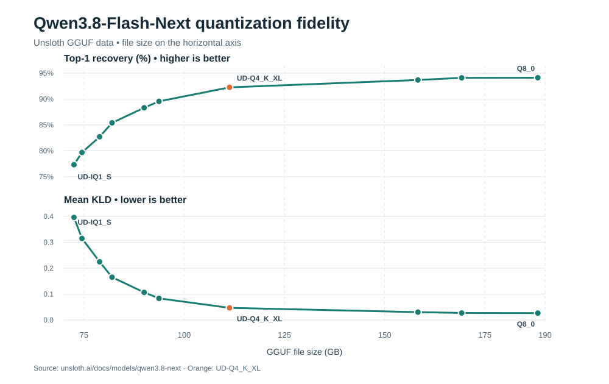
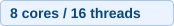
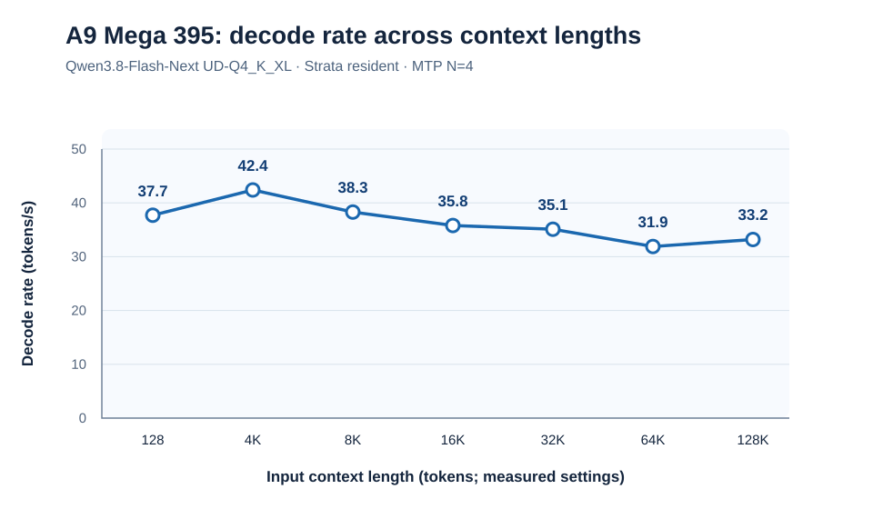
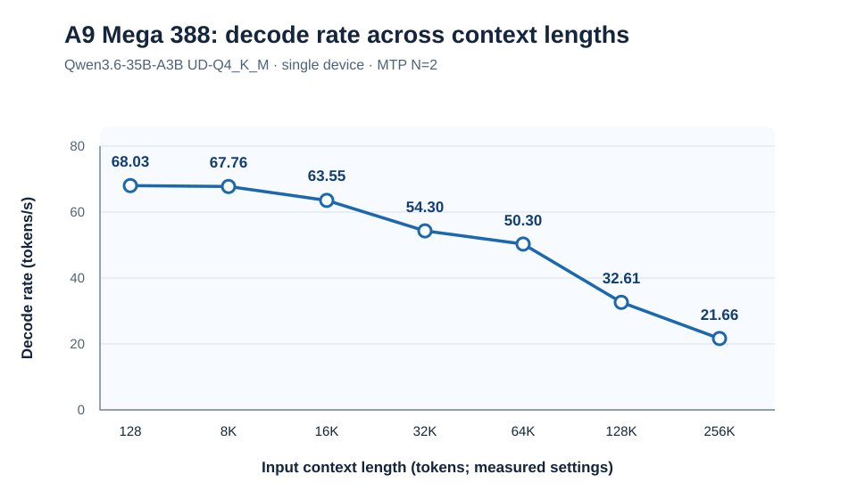

# Local LLM Inference on GEEKOM A9 Mega

This repository answers three questions for end customers, using data measured on physical GEEKOM hardware:

1. When running a large language model locally on a mini PC, **which quantization level should you choose?**
2. Once that level is chosen, **what performance can each GEEKOM A9 Mega model — the A9 Mega 395 (128 GB) and the A9 Mega 388 (64 GB) — actually deliver?**
3. **Which model should you pick for each device?**

The short answer: **4-bit quantization is the sweet spot between file size and model fidelity**, and it is the level used for the recommended configurations in this repository.

Section 5 turns those results into a concrete shortlist: the **strongest 4-bit recommendation for the A9 Mega 395** and **three recommended models for the A9 Mega 388**. The 395 is the higher-spec model, with more CPU cores and twice the memory (128 GB vs. 64 GB); the 388 is the more cost-effective choice. With **Strata**, both devices ran the 111.4 GB Qwen3.8-Flash-Next flagship on a single device: the 395 used memory-resident experts, while the 388 used SSD-backed weights. The shortlist highlights useful choices rather than covering every supported model.

All performance data was measured on physical GEEKOM units. **Device configurations, model filenames, and runtime settings are published with the results**; full launch commands are included where available, and anything not tested is marked as such rather than assumed.

Full records for each device, including test commands, VRAM usage, and notes:

- A9 Mega 395 — [earlier llama.cpp archive](./docs/A9-Mega-395/) and [56 Strata measurements](./docs/A9-Mega-395/Qwen3.8-Flash-Next-Strata.md)
- A9 Mega 388 — [test archive, including Strata Q4 and IQ3_S runs](./docs/A9-Mega-388/), and [IQ3_S performance summary](./docs/A9-Mega-388/Qwen3.8-Flash-Next-Strata.md)

This root README summarizes the benchmarks. Device-specific installation guides can be added to those folders when the setup steps have been verified.

**Community:** Questions or results to share? Join the [GEEKOM AI Discord](https://discord.gg/8WxyT7yvhw) or open a thread in this repository's Discussions tab.

## Model performance at a glance

Headline results for the models tested on the A9 Mega 395 and A9 Mega 388: **generation speed and TTFT use 128-token input; prompt-processing speed uses 32K-token input for every model**. See [Section 4](#4-measured-4-bit-performance-by-device) for longer context lengths, deployment, and per-device detail.

| Model / Quantization | Model Size (GB) | Generation Speed, 128-token input (token/s) | Prompt Processing, 32K input (token/s) | TTFT, 128-token input (s) |
| :---: | :---: | :---: | :---: | :---: |
| Qwen3.8-Flash-Next `UD-Q4_K_XL` — 395, Strata memory-resident | 111.4 | 37.7 | 1212 | 0.46 |
| Qwen3.8-Flash-Next `UD-Q4_K_XL` — 388, Strata SSD-backed | 111.4 | 18.9 | 441 | 3.33 |
| DeepSeek-V4-Flash-0731 `UD-Q2_K_XL` | 96.8 | 14.71 | 108.45 | 0.99 |
| Qwen3.6-35B-A3B `UD-Q4_K_M` | 22.7 | 68.03 | 1007.86 | 0.16 |
| Gemma-4-31B `q4_0` | 16.4 | 11.28 | 41.45 | 4.77 |
| Qwen3.8-27B `FP4-FAST` | 14.6 | 31.29 | 276.48 | 0.40 |
| MiniCPM5-2B `Q4_K_M` | 1.56 | 103.10 | 1550.16 | 0.10 |

Source: recorded test data in the device archives ([A9 Mega 395 Strata](./docs/A9-Mega-395/Qwen3.8-Flash-Next-Strata.md), [earlier A9 Mega 395 results](./docs/A9-Mega-395/), [A9 Mega 388](./docs/A9-Mega-388/)). The Qwen3.8-Flash-Next rows use Strata with MTP N=4; the other rows retain their earlier engine configurations. Figures are for single-device runs. Longer-context results are reported below.

## Contents

1. [Quantization level vs. memory requirement](#1-quantization-level-vs-memory-requirement)
2. [Quantization level vs. model fidelity](#2-quantization-level-vs-model-fidelity)
3. [Conclusion: 4-bit is the sweet spot](#3-conclusion-4-bit-is-the-sweet-spot)
4. [Measured 4-bit performance by device](#4-measured-4-bit-performance-by-device)
5. [Recommended models by device](#5-recommended-models-by-device)

---

## 1. Quantization level vs. memory requirement

Quantization means **representing model weights with fewer bits** (often summarized as *bits per weight*, or **bpw**). Labels such as `Q4_K_XL` name quantization schemes; they do not mean every weight uses exactly four bits. For **Qwen3.8-Flash-Next**, [Unsloth's hardware requirements table](https://unsloth.ai/docs/models/qwen3.8-next) gives these approximate total memory requirements (RAM plus VRAM, or unified memory):

| Quantization level | 1-bit | 2-bit | 3-bit | 4-bit | 5-bit | 8-bit | BF16 |
| --- | --- | --- | --- | --- | --- | --- | --- |
| Typical GGUF quantization | `IQ1_S` / `IQ1_M` | `Q2_K_XL` | `IQ3_XXS` / `Q3_K_XL` | `IQ4_XS` / `Q4_K_XL` | `Q5_K_XL` | `Q8_0` | BF16 |
| Approximate total memory requirement | 75 GB | 79 GB | 90 GB | 96–114 GB | 163 GB | 200 GB | 355 GB |

Three points follow from this table:

- **Required memory grows with quantization level**: the more precision used per weight, the more storage and runtime memory the model needs. Exact requirements depend on the quantization scheme and runtime settings.
- **Memory grows gently at low quantization levels**: 1-bit to 4-bit only moves from 75 GB to 96–114 GB (roughly +30% to +50%), yet that is already enough to hold this hundred-gigabyte-class flagship model.
- **Memory expands sharply at high quantization levels**: BF16 (355 GB) is more than three times the 4-bit range, and 8-bit (200 GB) is likewise far beyond the memory capacity of a mainstream mini PC. Both place an order-of-magnitude higher demand on memory capacity and memory bandwidth.

**What this means when choosing a device**: model weights, draft weights, runtime overhead, and the context cache (KV cache) all need memory. The table above describes memory requirements for the cited configurations; SSD offload changes how much must remain resident. Strata ran the 111.4 GB 4-bit model through 128K input tokens on both a single 128 GB 395 with memory-resident experts and a single 64 GB 388 with SSD-backed weights (Sections 4.2–4.3). The earlier llama.cpp setup used a separate 2.8 GB MTP draft model and different memory handling. Memory capacity, engine, residency mode, and storage all affect which configurations a device can serve.

## 2. Quantization level vs. model fidelity

[Unsloth's Qwen3.8-Flash-Next quantization analysis](https://unsloth.ai/docs/models/qwen3.8-next#quantization-analysis) reports the following GGUF file sizes and fidelity metrics. Its chart titles abbreviate the model name to “Qwen3.8-Flash”; the data appears within the Flash-Next guide. **Top-1** measures recovery of the reference model's first-choice output token, and **mean KLD** measures the difference between output distributions (lower is better). These are model-fidelity metrics, not task accuracy scores.



| GGUF quantization | Disk size (GB) | Top-1 recovery (%) | Mean KLD |
| --- | ---: | ---: | ---: |
| `UD-IQ1_S` | 72.5 | 77.325 | 0.396070 |
| `UD-IQ1_M` | 74.5 | 79.691 | 0.314739 |
| `UD-Q2_K_XL` | 78.9 | 82.715 | 0.224607 |
| `UD-IQ3_XXS` | 82.0 | 85.414 | 0.165120 |
| `UD-Q3_K_XL` | 90.0 | 88.315 | 0.106504 |
| `UD-IQ4_XS` | 93.7 | 89.554 | 0.083630 |
| `UD-Q4_K_XL` | 111.3 | 92.255 | 0.046893 |
| `UD-Q5_K_XL` | 158.3 | 93.680 | 0.030415 |
| `UD-Q6_K_XL` | 169.2 | 94.089 | 0.027091 |
| `Q8_0` | 188.2 | 94.122 | 0.026574 |

These are Unsloth's published figures for its quantizations. They do not measure accuracy on user tasks or compare different model families.

## 3. Conclusion: 4-bit is the sweet spot

The Unsloth memory requirements in Section 1 and its GGUF fidelity measurements in Section 2 support these observations for Qwen3.8-Flash-Next:

1. **Fidelity and size are positively correlated**: higher quantization gives higher Top-1 recovery and lower KLD, and the two metrics corroborate each other.
2. **Marginal returns diminish above ~111 GB (`UD-Q4_K_XL`)**: `UD-Q5_K_XL` (158.3 GB, 93.680% Top-1, 0.030415 KLD) and `Q8_0` (188.2 GB, 94.122% Top-1, 0.026574 KLD) add only about 1%–2% more Top-1 and a KLD improvement from about 0.05 to about 0.03 — for 1.4×–1.7× the 4-bit size, a cost out of proportion to the gain.
3. **Low-bit quantization costs a lot**: `UD-IQ1_S` (72.5 GB) reaches only 77.325% Top-1 with 0.396070 KLD, and `UD-Q2_K_XL` (78.9 GB) reaches 82.715% Top-1 with 0.224607 KLD — capacity saved, fidelity lost.
4. **At the same file size, the quantization scheme matters**: `UD-IQ4_XS` is 93.7 GB with 89.554% Top-1, while `UD-Q4_K_XL` is 111.3 GB with 92.255% Top-1. The two “4-bit” choices differ in size and fidelity.

> **4-bit quantization such as `UD-Q4_K_XL` is therefore the sweet spot**: it delivers near-saturated fidelity (Top-1 recovery about 92%, KLD below 0.05) at 111.3 GB, close to the 111.4 GB model size recorded in the A9 Mega tests. Unsloth's fidelity figures should not be assumed for other models or quantizations.
>
> This is why the main device recommendations in this repository **use 4-bit quantization**. This does not establish the best quantization for every model or task. Non-4-bit models are documented separately; the 2-bit `DeepSeek-V4-Flash-0731-UD-Q2_K_XL` is also discussed as an alternative for the 395 in Section 5.1.

## 4. Measured 4-bit performance by device

### 4.1 Devices and hardware configuration

| Item | A9 Mega 395 | A9 Mega 388 |
| --- | --- | --- |
| Processor | AMD Ryzen AI MAX+ 395 | AMD Ryzen AI MAX+ 388 |
| CPU cores / threads |  |  |
| Graphics | Radeon 8060S | Radeon 8060S |
| Memory bandwidth | 256 GB/s | 256 GB/s |
| Memory size |  |  |
| Operating system | Ubuntu 26.04 | Ubuntu 26.04 |
| Graphics driver | 31.50.0.0 | 31.50.0.0 |


> Both devices use the same listed graphics processor and memory bandwidth. The **395 has twice the CPU cores and threads (16/32 vs. 8/16) and twice the memory (128 GB vs. 64 GB)**, making it the higher-spec model; the **388 is the more cost-effective option**. Memory capacity affects how much of a model can remain resident. Strata's SSD-backed mode also allowed the 388 to run the 111.4 GB model on one device; the earlier llama.cpp configuration used a two-device cascade.

### 4.2 Primary model on A9 Mega 395: Qwen3.8-Flash-Next UD-Q4_K_XL

A9 Mega 395 single-device test conditions:

| Item | Configuration |
| --- | --- |
| Model | `Qwen3.8-Flash-Next-UD-Q4_K_XL.gguf` (111.4 GB, the upper end of the 4-bit range in Section 1) |
| Engine | Strata `0.2.2-100400` |
| Acceleration | MTP N=4 (`--spec 4`, `--mtp`, `--mtp-q4 all`, `--mtp-window 8192`) |
| Context length | `--max-context 256000`, `--kv int8`; measured through 128K input tokens |
| Expert settings | `--resident-experts --expert-cache auto --prefill auto` |
| Deployment | Single device, memory-resident experts |



The points are spaced evenly by measured setting for readability; their horizontal distances are not proportional to token count.

| Input tokens | Decode (tokens/s) | Prefill (tokens/s) | TTFT (s) |
| --- | ---: | ---: | ---: |
| 128 | 37.7 | 294 | 0.46 |
| 4K | 42.4 | 963 | 4.28 |
| 8K | 38.3 | 1043 | 7.88 |
| 16K | 35.8 | 1146 | 14.32 |
| 32K | 35.1 | 1212 | 27.06 |
| 64K | 31.9 | 1219 | 53.79 |
| 128K | 33.2 | 1175 | 111.58 |

At 128K, this Strata configuration delivers **2.15× the decode throughput** and **85% lower TTFT** than the earlier single-device llama.cpp Q4 run (15.45 tokens/s, 720.61 s TTFT). Engine, MTP implementation and depth, and memory handling differ, so this compares complete configurations. The [395 Strata report](./docs/A9-Mega-395/Qwen3.8-Flash-Next-Strata.md) also covers MTP-off baselines, SSD-backed Q4 (29.1 tokens/s at 128K), and the 83.6 GB IQ3_S model (37.2 tokens/s at 128K with memory-resident experts). IQ3_S is a separate quantization without a fidelity evaluation in this repository.

### 4.3 A9 Mega 388: Qwen3.8-Flash-Next and other 4-bit models

**Strata 0.2.2 runs the 111.4 GB Qwen3.8-Flash-Next UD-Q4_K_XL on a single 64 GB 388 using SSD-backed weights**, with MTP N=4 and an INT8 KV cache. The configured context limit is 256000; measurements cover 128 through 128K input tokens.

| Input tokens | Decode (tokens/s) | Prefill (tokens/s) | TTFT (s) |
| --- | ---: | ---: | ---: |
| 128 | 18.9 | 39 | 3.33 |
| 4K | 17.0 | 366 | 11.25 |
| 8K | 19.5 | 370 | 22.19 |
| 16K | 19.7 | 421 | 38.97 |
| 32K | 18.1 | 441 | 74.36 |
| 64K | 20.2 | 454 | 144.40 |
| 128K | 19.9 | 423 | 309.91 |

This configuration sustains **17.0–20.2 tokens/s** across the measured inputs without a second device. [Q4 measurements and launch command](./docs/A9-Mega-388/README.md#37-strata-ssd-resident-qwen38-flash-next-ud-q4_k_xlgguf-1114-gb-mtp-n4)

The separate **83.6 GB GSQ-RCO-IQ3_S** Strata configuration reaches **24.7–31.3 tokens/s**, including **24.9 tokens/s at 128K** with **208.42 s TTFT**. It offers higher measured throughput with a different quantization; output quality has not been compared here. [388 IQ3_S report](./docs/A9-Mega-388/Qwen3.8-Flash-Next-Strata.md)

#### Smaller 4-bit models

The recommended single-device `Qwen3.6-35B-A3B-UD-Q4_K_M` (22.7 GB, MTP N=2) was measured at seven input lengths:



The points are spaced evenly by measured setting for readability; their horizontal distances are not proportional to token count. At 256K, the model decoded at **21.66 tokens/s** with a **645.04 s** time to first token. The [A9 Mega 388 test archive](./docs/A9-Mega-388/) has the full measurements and single-device command.

The table below summarizes three 4-bit models through 128K input tokens:

| Model | Size | Acceleration | 128 | 8K | 16K | 32K | 64K | 128K |
| --- | --- | --- | --- | --- | --- | --- | --- | --- |
| Qwen3.8-27B-UD-Q4_K_XL | 17.6 GB | MTP N=4 | 20.24 | 21.30 | 19.53 | 16.87 | 12.86 | 9.88 |
| Qwen3.6-35B-A3B-UD-Q4_K_M | 22.7 GB | MTP N=2 | 68.03 | 67.76 | 63.55 | 54.30 | 50.30 | 32.61 |
| MiniCPM5-2B-Q4_K_M | 1.56 GB | No | 103.10 | 87.08 | 75.15 | 61.74 | 44.76 | 29.03 |

Corresponding time to first token (s):

| Model | 128 | 8K | 16K | 32K | 64K | 128K |
| --- | --- | --- | --- | --- | --- | --- |
| Qwen3.8-27B-UD-Q4_K_XL | 0.44 | 24.54 | 52.44 | 109.55 | 268.94 | 646.85 |
| Qwen3.6-35B-A3B-UD-Q4_K_M | 0.16 | 6.61 | 14.79 | 32.51 | 103.58 | 218.14 |
| MiniCPM5-2B-Q4_K_M | 0.10 | 3.09 | 7.52 | 21.14 | 70.63 | 255.42 |

**Reading the results**:

- **MoE models around 35B-A3B are the 388's comfort zone**: `Qwen3.6-35B-A3B-UD-Q4_K_M` (22.7 GB) decodes at 54.30 tokens/s at 32K, 32.61 tokens/s at 128K, and 21.66 tokens/s at 256K.
- 27B-class dense models drop to 5–10 tokens/s at long context, so they suit medium context lengths.
- The tested 2B model (`MiniCPM5-2B-Q4_K_M`, a 1.56 GB file with reported VRAM usage of roughly 15–18 GB) reaches 103.10 tokens/s at 128 input tokens; its decode rate falls to 29.03 tokens/s at 128K.

> **Scope note**: the [388 archive](./docs/A9-Mega-388/) records every tested configuration. Only the three 388 models listed in **Section 5.2** are promoted to the recommendation shortlist; the other configurations, including `Qwen3.8-27B-UD-Q4_K_XL` and the triple-node cascade, remain measured records.

### 4.4 Other 4-bit models on the A9 Mega 395 (decode rate, tokens/s)

| Model | Acceleration | 128 | 8K | 16K | 32K | 64K | 128K |
| --- | --- | --- | --- | --- | --- | --- | --- |
| Qwen3.8-27B-FP4-FAST | MTP N=4 | 31.29 | 25.43 | 24.51 | 20.28 | 15.42 | 8.95 |

Corresponding time to first token (s):

| Model | 128 | 8K | 16K | 32K | 64K | 128K |
| --- | --- | --- | --- | --- | --- | --- |
| Qwen3.8-27B-FP4-FAST | 0.40 | 23.56 | 51.11 | 118.52 | 306.21 | 865.62 |

> **Scope note**: the 395 was also tested with the **2-bit** `DeepSeek-V4-Flash-0731-UD-Q2_K_XL` (96.8 GB, in single-device, dual-node cascade, and triple-node cascade deployments), which is not 4-bit, so it is not listed in this section. Within the 4-bit results, `Qwen3.8-Flash-Next-UD-Q4_K_XL` remains the primary recommendation in **Section 5.1**, while `Qwen3.8-27B-FP4-FAST` is kept as a measured record. Full records are in [`docs/A9-Mega-395/`](./docs/A9-Mega-395/).

### 4.5 Reproduction commands

<details>
<summary>Strata: 395 — single device, memory-resident Qwen3.8-Flash-Next UD-Q4_K_XL, MTP N=4</summary>

```bash
cd /home/user/Strata-0.2.2-100400 && source /home/user/strata-rocm100400/scripts/env-100400.sh && printf '%s\n' '{"exe":"/home/user/Strata-0.2.2-100400/build-halo-100400/strata","args":["--pack","/home/user/.local/share/strata/Strata-data/packs/unsloth-ud-q4_k_xl","--native","/home/user/mode/Qwen3.8-Flash-Next-UD-Q4_K_XL/Qwen3.8-Flash-Next-UD-Q4_K_XL-00001-of-00004.gguf","--resident-experts","--expert-profile","/home/user/Strata-0.2.2-100400/data/expert-profile.bin","--expert-cache","auto","--prefill","auto","--spec","4","--spec-min-p","0.5","--suffix-draft","0","--mtp","/home/user/.local/share/strata/Strata-data/mtp/rt-official","--mtp-q4","all","--mtp-window","8192","--max-context","256000","--kv","int8","--ple-io","direct","--vram-reserve-mib","700"],"cwd":"/home/user/Strata-0.2.2-100400","tokenizer":"/home/user/.local/share/strata/Strata-data/packs/unsloth-ud-q4_k_xl/tokenizer","model_name":"qwen3.8-q4-resident-official-mtp","log":"strata-q4-resident-official-mtp.log","host":"127.0.0.1","lib_dirs":["/home/user/strata-rocm100400/lib/python3.12/site-packages/_rocm_sdk_devel/lib","/home/user/strata-rocm100400/lib/python3.12/site-packages/_rocm_sdk_libraries_gfx1151/lib"],"sampling":{"temperature":1.0,"top_p":0.95,"top_k":20},"env":{"STRATA_HIPBLASLT_TUNING":"/home/user/Strata-0.2.2-100400/tools/hip/gfx1151-hipblaslt-100400.txt","STRATA_IGPU_PROMPT_SET":"1","STRATA_PF_FUSED":"1","STRATA_HC_Q8":"1","STRATA_PF_SWITCH_MIN_T":"4096","STRATA_PREFILL_STREAM_MIN":"128","STRATA_PF_FUSED_KQ":"1","STRATA_PF_F16":"1","STRATA_REFILL_PARTS":"1","STRATA_SPEC_COUPLED":"1","STRATA_SPEC_GUMBEL":"1","STRATA_SPEC_DEPTH":"1"}}' | /home/user/strata-rocm100400/bin/python -m serve.server --engine strata --port 8082 --config /dev/stdin
```

</details>


<details>
<summary>Earlier llama.cpp configuration: 395 — single device, Qwen3.8-Flash-Next UD-Q4_K_XL</summary>

```bash
./llama-server -m /home/user/mode/Qwen3.8-Flash-Next-UD-Q4_K_XL/Qwen3.8-Flash-Next-UD-Q4_K_XL-00001-of-00004.gguf -ngl 99 -c 256000 -b 4096 -ub 2048 -fa on -np 1 --host 127.0.0.1 --port 8080 --metrics -lv 4 -md /home/user/mode/Qwen3.8-Flash-Next-UD-Q4_K_XL/mtp-Qwen3.8-Flash-Next-Q4_K_M.gguf -ngld 99 --spec-type draft-mtp --spec-draft-n-max 2
```

</details>

<details>
<summary>Earlier llama.cpp configuration: 388 — dual-node cascade, Qwen3.8-Flash-Next UD-Q4_K_XL</summary>

```bash
# On the worker
LD_LIBRARY_PATH="$PWD:$PWD/lib:$PWD/bin:$LD_LIBRARY_PATH" && ./ggml-rpc-server -H 192.168.10.10 -p 50052 -t 16

# On the host (after starting the worker)
./llama-server -m /home/user/Qwen3.8-Flash-Next-UD-Q4_K_XL/Qwen3.8-Flash-Next-UD-Q4_K_XL-00001-of-00004.gguf -ngl 99 -c 256000 -b 2048 -ub 1024 -fa on -np 1 --rpc 192.168.10.10:50052 --host 127.0.0.1 --port 8080 --metrics -lv 4 -md /home/user/Qwen3.8-Flash-Next-UD-Q4_K_XL/mtp-Qwen3.8-Flash-Next-Q4_K_M.gguf -ngld 99 --spec-type draft-mtp --spec-draft-n-max 2
```

</details>

For additional Strata settings, see the [395 runtime settings](./docs/A9-Mega-395/Qwen3.8-Flash-Next-Strata.md#runtime-settings-and-data-limits) and the [388 Q4 launch command](./docs/A9-Mega-388/README.md#37-strata-ssd-resident-qwen38-flash-next-ud-q4_k_xlgguf-1114-gb-mtp-n4). The llama.cpp commands above reproduce the earlier archived configurations.

These are recorded test commands with machine-specific file paths and network addresses. Reproduction requires the corresponding model files, the matching Strata or llama.cpp build and dependencies, and paths and addresses appropriate to the test environment.

---

## 5. Recommended models by device

The 4-bit results in Section 4 reduce to a short, device-specific shortlist. Strata runs the featured Qwen3.8-Flash-Next model on either device, with memory-resident experts on the 395 and SSD-backed weights on the 388. The two smaller models recommended for the 388 were also tested on the 395, but those results are not included in this repository, so no 395 performance figures are quoted for them here. These recommendations do not exhaust either device's possible configurations.

### 5.1 A9 Mega 395 — primary recommendation and another capable option

| Role | Model | File size | Deployment |
| --- | --- | --- | --- |
| Strongest model | `Qwen3.8-Flash-Next-UD-Q4_K_XL.gguf` | 111.4 GB | Single device, Strata memory-resident |

With Strata and MTP N=4, the 395 runs this hundred-gigabyte-class 4-bit flagship **on a single device** (Section 4.2). It decodes at **37.7 tokens/s at 128 input tokens**, peaks at **42.4 tokens/s at 4K**, and reaches **33.2 tokens/s at 128K**. TTFT is **0.46 s at 128 tokens** and **111.58 s at 128K**. Memory readings and the separate SSD-backed configuration are detailed in the [395 Strata report](./docs/A9-Mega-395/Qwen3.8-Flash-Next-Strata.md).

**DeepSeek-V4-Flash-0731 is another competitive model choice** for the 395. Its `UD-Q2_K_XL` version (96.8 GB, 2-bit) was tested on a single device through 256K input tokens; it decoded at 14.71 tokens/s at 128 tokens, 9.71 tokens/s at 128K, and 7.16 tokens/s at 256K ([395 test archive](./docs/A9-Mega-395/)). It sits outside the 4-bit recommendation table, and this repository does not provide a head-to-head intelligence benchmark between it and Qwen3.8-Flash-Next.

### 5.2 A9 Mega 388 — three recommended models

| # | Role | Model | File size | Deployment | Why |
| --- | --- | --- | --- | --- | --- |
| 1 | Flagship with SSD offload | `Qwen3.8-Flash-Next-UD-Q4_K_XL.gguf` | 111.4 GB | Single device, Strata SSD-backed | 18.9 tokens/s at 128 input tokens and 19.9 at 128K; no second device required (Section 4.3). |
| 2 | Balanced everyday default | `Qwen3.6-35B-A3B-UD-Q4_K_M.gguf` | 22.7 GB | Single device | MoE 35B-A3B; 54.30 tokens/s at 32K, 32.61 at 128K, and 21.66 at 256K (Section 4.3). |
| 3 | Lightweight, high-throughput | `MiniCPM5-2B-Q4_K_M.gguf` | 1.56 GB | Single device | High throughput at short context: 103.10 tokens/s at 128 input tokens, falling to 29.03 tokens/s at 128K (Section 4.3). |

> **Compatibility note**: the flagship has published test records for both devices. The two smaller models were also tested on the 395, but those records have not been added to this repository; their 395 performance is not reported here.

Pick the higher-spec **A9 Mega 395** (128 GB) for the faster recorded Qwen3.8-Flash-Next Q4 configuration: **33.2 tokens/s at 128K** with Strata. The more cost-effective **A9 Mega 388** (64 GB) runs the same Q4 model with SSD offload at **19.9 tokens/s at 128K**, or its smaller 35B-A3B everyday model at **54.30 tokens/s at 32K**. The earlier dual-node llama.cpp deployment remains an archived option.

> These conclusions apply only to the configurations recorded in this repository. Changing software versions, models, context length, or power profile may change the results, and data from a single device should not be generalized into guaranteed performance across all GEEKOM configurations.

## Known limitations

The table separates observed limits from details that still need verification.

| Item | Limitation or open item |
| --- | --- |
| Maximum tested context | The featured **Qwen3.8-Flash-Next Strata runs on both devices** were measured through 128K input tokens (`--max-context 256000` configured); no 256K Strata result is recorded. The **A9 Mega 388** single-device `Qwen3.6-35B-A3B-UD-Q4_K_M` run was measured through 256K. Other models and deployments have different measured limits; see the device archives. |
| Memory and storage | The 111.4 GB Q4 model exceeds the 388's 64 GB physical memory, but Strata's SSD-backed mode runs it on one device. The 395 was measured with both memory-resident and SSD-backed experts. Model file size is not a total physical memory requirement; storage performance and residency settings affect SSD-backed runs. The Strata memory readings retain two-part notation whose accounting has not been fully documented. |
| Long-context throughput | TTFT grows with input length. Decode behavior depends on the configuration: the 395 Strata Q4 run records 31.9–42.4 tokens/s and the 388 Strata Q4 run 17.0–20.2 tokens/s across the measured inputs; the smaller models and earlier engines have different context scaling. |
| Strata test coverage | Each model / residency / acceleration setting has one measurement per input length. Repeated-run variability, SSD specifications, and output-quality comparisons are not recorded. IQ3_S performance does not establish fidelity equivalent to Q4. |
| Test conditions not yet published | BIOS, NPU driver, and power profile are still "To be confirmed". |
| Offline use | Local operation does not mean every step works offline: models, software, dependencies, and required resources must be downloaded and configured before the device is disconnected from the internet. |

## Responsible use

This is an experimental reference project, not a guarantee that every model or third-party application will work on every configuration. Model outputs may be inaccurate. Do not use generated output as the sole basis for medical, legal, financial, safety-critical, or other high-impact decisions.

The performance data here was measured on specific, disclosed configurations. Background applications, software versions, model settings, ambient conditions, and power profiles can affect performance, so results from one device should not be read as guaranteed performance for every GEEKOM configuration.

Support: questions and reproduction reports are welcome via GitHub Issues. This is a community reference project maintained by the GEEKOM team; we review new issues on business days and prioritise reports that include the model file, launch command, and device (395 or 388) used.

## Related resources

- [GEEKOM Resource Center](https://github.com/GEEKOMOfficial/geekom-resource-center)
- [GEEKOM Official Website](https://www.geekompc.com/)
- [GEEKOM Support](https://www.geekompc.com/support/)

## License

- Benchmark data and documentation in this repository are licensed under CC BY 4.0 — the same terms as the dataset release: https://huggingface.co/datasets/geekom-ai/a9-mega-local-llm-benchmarks
- Code (scripts and tooling) is licensed under the MIT License (see LICENSE).
